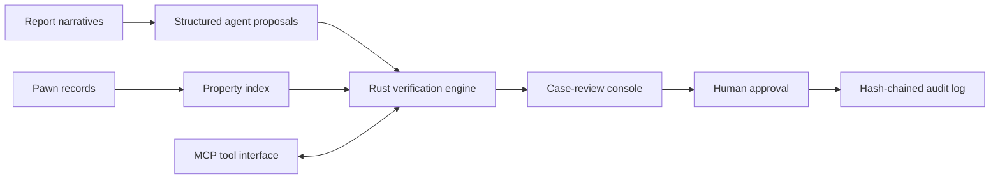

# Casefile

A Rust investigation workbench that combines AI proposals with deterministic
verification, cited evidence and human approval. Built for an ESEC x NetworkAI 2026 case competition.

**Technical lead: Kevin Pham — system architecture, performance optimization and evaluation.**

Casefile connects related burglary reports, matches stolen property against pawn
records, and assembles a reviewable lead packet. Its central design separates
flexible language-model work from decisions that need exact, reproducible checks.

## Architecture



- **Pure Rust core:** case linkage, feasibility checks, property matching,
  solvability scoring and citation validation.
- **Agent boundary:** typed MCP tools expose the engine; recorded outputs make
  the demo reproducible and usable offline.
- **Review workflow:** proposals retain their evidence, checks and approval
  decisions in one case workspace.
- **Exact optimization:** time sweeps, score bounds, inverted indexes and bounded
  heaps accelerate the engine while preserving brute-force reference outputs.

## Engineering results

Release-build benchmarks on the 2,000-case, 1,510-record synthetic workload
(2026-11-20, median of three runs):

| Operation | Reference | Optimized | Speedup |
|---|---:|---:|---:|
| Series proposals | 217.4 ms | 13.5 ms | 16.1x |
| Property matching | 5,173.2 ms | 95.0 ms | 54.4x |
| Similar cases, 50 lookups | 21.8 ms | 11.7 ms | 1.9x |

Each timed comparison checks output equality. The [benchmark report](evals/bench.md)
records the dataset, repetitions and candidate funnel. The
[algorithm notes](docs/ALGORITHMS.md) explain the bounds and correctness arguments.

## Run the demo

```sh
cargo run --locked -- serve
```

Open <http://localhost:8080>. The demo includes 2,000 synthetic cases, pawn records,
a curated review queue and recorded agent runs. It needs no model credentials.

Open `/algo.html` for the interactive algorithm explainer, or watch the
[demo video](media/demo.mp4).

## Explore the implementation

| Area | Start here |
|---|---|
| System design and data flow | [Architecture](docs/ARCHITECTURE.md) |
| Scoring, pruning and indexing | [Algorithms](docs/ALGORITHMS.md) |
| Tests, synthetic ground truth and benchmarks | [Validation](docs/VALIDATION.md) |
| Deterministic domain logic | [crates/core](crates/core/src/lib.rs) |
| MCP, HTTP, replay and audit | [crates/casefile](crates/casefile/src/main.rs) |
| Review console | [ui](ui/README.md) |

## Check the work

```sh
cargo build --locked
cargo test --locked
cargo clippy --locked --all-targets -- -D warnings
cargo run --release --locked -- bench --scales 1 --reps 3
```

The evaluation uses planted synthetic ground truth. Agent prompts are maintained
separately; the checked-in recordings support the public offline demo.

## Project origin

This repository presents the technical system
and architecture; the [original team project](https://github.com/StevenMC06/burglary-backlog-case)
preserves the collaborative project history. Vendor notices are in
[ui/vendor/LICENSES.txt](ui/vendor/LICENSES.txt).
