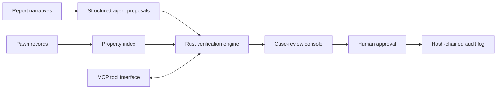
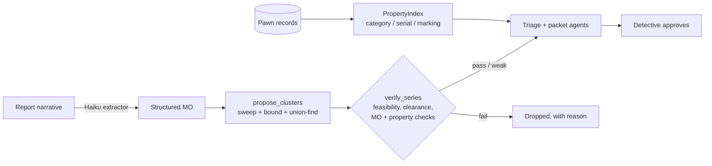
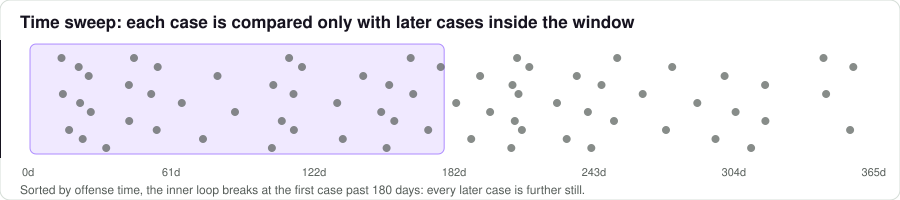
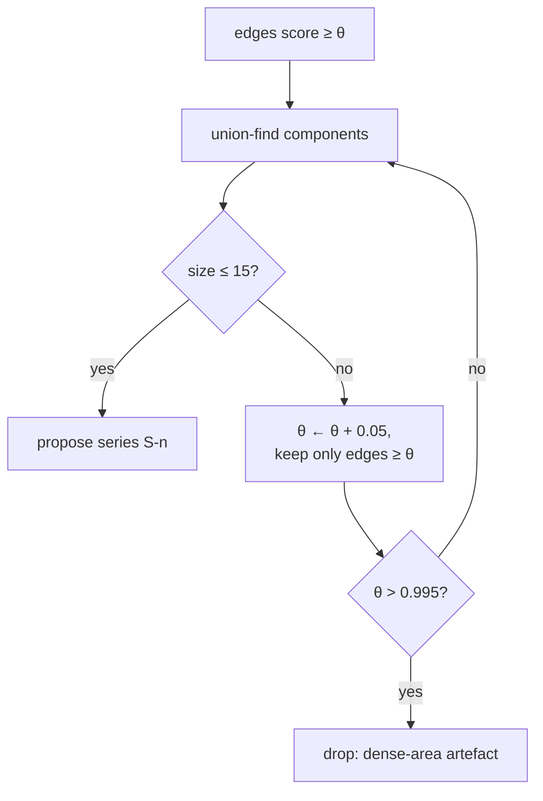
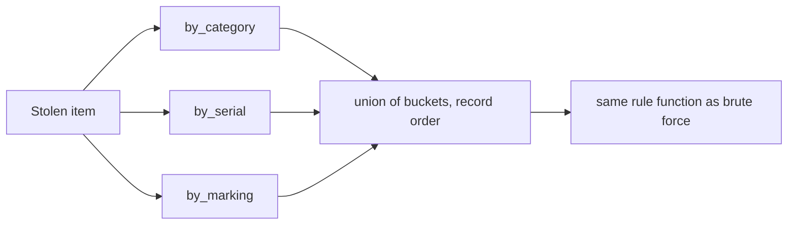

# Casefile


**Technical lead: Kevin Pham — system architecture, performance optimization and evaluation.**

Casefile connects related burglary reports, matches stolen property against pawn
records, and assembles a reviewable lead packet. Its central design separates
flexible language-model work from decisions that need exact, reproducible checks.

## Case context

Casefile was built for the **ESEC x NetworkAI 2026 case competition, “Cracking the Burglary Backlog.”** The brief centered on Cascade City, a fictional West Coast city where limited detective capacity leaves burglary reports, recurring patterns and stolen-property records disconnected.

The case baseline allocated **330 minutes of investigative work per burglary**, totaling **$3.05 million annually**. The challenge set two targets: reduce investigative labor costs by **15% net of implementation and operating costs**, and increase clearances by **25% relative to the baseline**.


## Demo

https://github.com/user-attachments/assets/a61eabe3-ed15-48cc-8b6f-8b95e0082d25

[Download the offline demo video](media/demo.mp4).

## Architecture



- **Pure Rust core:** case linkage, feasibility checks, property matching,
  solvability scoring and citation validation.
- **Agent boundary:** typed MCP tools expose the engine; recorded outputs make
  the demo reproducible and usable offline.
- **Review workflow:** proposals retain their evidence, checks and approval
  decisions in one case workspace.
- **Exact optimization:** time sweeps, score bounds, inverted indexes and bounded
  heaps accelerate the engine while preserving brute-force reference outputs.

## Run the demo

```sh
cargo run --locked -- serve
```

Open <http://localhost:8080>. The demo includes 2,000 synthetic cases, pawn records,
a curated review queue and recorded agent runs. It needs no model credentials.


## How the engine works

**Interactive version:** run the console and open **`/algo.html`** (button "How it works"), or just open `ui/algo.html` in a browser. It starts with a one-minute plain-English explanation, then the interactive panels, then **every formula with proofs** (KaTeX, vendored, works offline). The panels: live sliders for the score, an animated time sweep, the pruning region over real pairs, union-find clustering with re-split, a step-through top-k heap and the pawn index. Formula rendering uses vendored KaTeX and works offline.



### 1. Pair score

Two cases $a,b$ get a log-odds score from MO agreement $m\in[0,1]$, distance $d$ (km), time gap $t$ (days) and shared behavioural signatures $s$:

```math
z = -0.4 + 6.0\,m \;-\; 1.3\ln(1+d) \;-\; 0.9\ln(1+t) \;+\; 0.6\min(s,3), \qquad \text{score} = \sigma(z) = \frac{1}{1+e^{-z}}
```

```math
m = 0.20\,[\text{premise}] + 0.15\,[\text{entry point}] + 0.15\,[\text{entry method}] + 0.10\,[\text{time band}] + 0.05\,[\text{weekday}] + 0.15\,J(\text{property}) + 0.20\,J(\text{signatures})
```

$[\cdot]$ is 1 on an exact, known match, and $J$ is Jaccard overlap. If either case has no MO, the score is halved, so it can never pass 0.5. The log terms make distance and time decay steepest near zero, as in the burglary-linkage literature. The weights are hand-set and pinned by tests (`crates/core/src/linkage.rs`).

### 2. Candidate series: sweep, bound, union-find

The reference enumerates $\binom{n}{2}$ pairs. The optimized path preserves its output with three cuts, checked against the brute-force oracle:



**Time sweep.** Sort cases by offense time. For each case, walk forward and `break` at the first case more than 180 days later, because every later case is further away still. Cost is $O(n\log n + P)$, where $P$ is the number of pairs inside the window.

**Upper-bound pruning.** MO comparison is the expensive part, and distance and time are known first. Since $m\le 1$ and $s\le\min(|S_a|,|S_b|)$, the following holds:

```math
\text{score}(a,b) \;\le\; \sigma\big(5.6 - 1.3\ln(1+d) - 0.9\ln(1+t) + 0.6\min(|S_a|,|S_b|,3)\big) =: \text{UB}(a,b)
```

If $\text{UB} < \theta$, the pair cannot become an edge, so it is skipped without any MO work. This is lossless because $\sigma$ is monotone and the MO weights are positive.




**Allocation-free scoring.** Property types become a 12-bit mask, so their Jaccard is `popcount(a&b) / popcount(a|b)`. Signatures are interned to sorted `u32` ids and compared with a merge walk. Work is split across threads, and edges are re-sorted by `(i, j)` so the output is deterministic.

**Union-find with re-split.** Edges with score $\ge\theta$ go into a disjoint-set forest (path halving, smallest-index root). A component larger than 15 cases is usually chaining (A~B~C~D…), so it is re-split at $\theta+0.05$ until it fits. One still too big at 0.995 is dropped, not proposed. Every group is only a hypothesis until `verify_series` checks it.



### 3. Similar cases: top-k with branch-and-bound

`similar_cases(case, k)` keeps a size-$k$ min-heap ordered by (score, then smaller id wins ties), which is $O(n\log k)$ instead of a full sort. Once the heap is full, a candidate with $\text{UB} <$ the heap minimum is skipped before MO scoring. Only the $k$ winners allocate a result.

### 4. Pawn matching: inverted index

Under the matching rules, a pawn record can only return a result for an item if it shares the item's **category** (conflicting serial or similar description), its normalised **serial** (an exact lead in any category) or a **marking** (a review candidate in any category). The index buckets records on those three keys, and each item is compared only with the union of its buckets. Every skipped record is provably a no-match. Records and items are normalised once (serials, lower-cased markings, description token sets) instead of once per comparison.



### 5. Measured results

Original scaling run: release build, median of three runs, using the original 1,500-record seed. The [scaling report](evals/bench-scaling.md) supplies the chart and table below.



| step | cases | brute force | optimised | speed-up | identical output |
|---|---:|---:|---:|---:|:---:|
| `propose_clusters` | 2,000 | 221.8 ms | 13.5 ms | **16.5×** | ✓ |
| `all_hits` | 2,000 | 5.26 s | 98.2 ms | **53.6×** | ✓ |
| `similar_cases` k=5, 50 lookups | 2,000 | 24.2 ms | 12.3 ms | **2.0×** | ✓ |
| `propose_clusters` | 4,000 | 554.3 ms | 36.9 ms | **15.0×** | ✓ |
| `all_hits` | 4,000 | 21.27 s | 367.1 ms | **57.9×** | ✓ |
| `similar_cases` k=5, 50 lookups | 4,000 | 42.5 ms | 20.2 ms | **2.1×** | ✓ |
| `propose_clusters` | 8,000 | 1.11 s | 61.8 ms | **18.0×** | ✓ |
| `all_hits` | 8,000 | 86.40 s | 1.80 s | **48.1×** | ✓ |
| `similar_cases` k=5, 50 lookups | 8,000 | 105.6 ms | 37.0 ms | **2.9×** | ✓ |

The server runs `all_hits` at startup, so faster property lookup also reduces startup work. On the original 2,000-case seed at $\theta = 0.9$, MO scoring runs on 68,781 of 1,999,000 pairs (3.4%). Scales 2x and 4x tile that seed one year apart; matching across repeated descriptions makes the pawn rows a scaling stress test.

The [current base-workload benchmark](evals/bench.md), with 2,000 cases and 1,510 pawn records, reports 16.1x faster series proposals, 54.4x faster property matching and 1.9x faster top-k retrieval.

Run the scaling comparison on the current seed:

```sh
cargo run --release --locked -- bench --scales 1,2,4 --reps 3
```

Regenerate the original figures from their preserved source report:

```sh
python -I tools/algo_figs.py evals/bench-scaling.md
```

Correctness checks compare each fast path with its brute-force reference on fuzzed data: `fast_clusters_equal_reference_on_fuzzed_data`, `fast_similar_cases_equal_reference_on_fuzzed_data` and `indexed_all_hits_equal_brute_force`. The pawn fuzz test also exercises all four match outcomes.

## Explore the implementation

| Area | Start here |
|---|---|
| System design and data flow | [Architecture](docs/ARCHITECTURE.md) |
| Scoring, pruning and indexing | [Algorithms](docs/ALGORITHMS.md) |
| Tests, synthetic ground truth and benchmarks | [Validation](docs/VALIDATION.md) |
| Deterministic domain logic | [crates/core](crates/core/src/lib.rs) |
| MCP, HTTP, replay and audit | [crates/casefile](crates/casefile/src/main.rs) |
| Review console | [ui](ui/README.md) |

## Check the work

```sh
cargo build --locked
cargo test --locked
cargo clippy --locked --all-targets -- -D warnings
cargo run --release --locked -- bench --scales 1 --reps 3
```
A Rust investigation workbench that combines AI proposals with deterministic
verification, cited evidence and human approval. 

The evaluation uses planted synthetic ground truth. Agent prompts are maintained
separately; the checked-in recordings support the public offline demo.

## Project origin

This repository presents the technical system
and architecture; the [original team project](https://github.com/StevenMC06/burglary-backlog-case)
preserves the collaborative project history. Vendor notices are in
[ui/vendor/LICENSES.txt](ui/vendor/LICENSES.txt).
