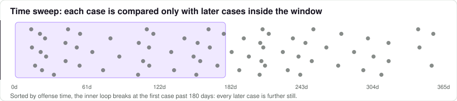

# Algorithms and exact fast paths

The engine keeps a brute-force reference beside each optimized path. The design
goal is lower candidate-processing cost with identical results.

## Case-linkage score

For two cases, the engine combines behavioral agreement `m`, distance `d` in
kilometers, time gap `t` in days and shared signatures `s`:

```math
z = -0.4 + 6.0m - 1.3\ln(1+d) - 0.9\ln(1+t) + 0.6\min(s,3)
```

```math
\operatorname{score}(a,b) = \frac{1}{1+e^{-z}}
```

Behavioral agreement uses weighted exact matches and Jaccard overlaps:

```math
m = 0.20[\text{premise}] + 0.15[\text{entry point}] + 0.15[\text{entry method}]
  + 0.10[\text{time band}] + 0.05[\text{weekday}]
  + 0.15J(\text{property}) + 0.20J(\text{signatures})
```

Unknown values contribute no agreement. The coefficients are hand-set ranking
parameters, pinned by tests in [linkage.rs](../crates/core/src/linkage.rs).

## Series proposals: sweep, bound, union-find

**Time sweep.** Sort cases by offense time and visit pairs within the 180-day
candidate window. Candidate enumeration costs `O(n log n + P)`, where `P` is the
number of pairs in the window.

**Score bound.** Full behavioral agreement bounds the expensive part of the score:

```math
\operatorname{UB}(a,b) = \sigma\left(5.6 - 1.3\ln(1+d) - 0.9\ln(1+t)
  + 0.6\min(|S_a|,|S_b|,3)\right)
```

If `UB < threshold`, skip behavioral comparison. The cut preserves qualifying
edges because the sigmoid is monotone and the behavioral weights are positive.

**Precomputed features.** Property categories become a bitmask; signatures become
sorted interned IDs. Jaccard operations use bit counts or a merge walk. Scoring
avoids per-pair allocation, and sorted edge output preserves deterministic order
across worker threads.

**Components.** Union-find groups qualifying edges. Components above 15 cases are
re-split at increasing thresholds to control chaining. The verifier evaluates the
resulting hypotheses against the case constraints.



## Similar cases: bounded top-k

The search maintains a size-`k` min-heap ordered by score and case ID. Once full,
the current minimum supplies a branch-and-bound threshold. Only the winning
results allocate output records. Heap maintenance costs `O(n log k)` rather than
sorting the entire candidate set.

## Property matching: inverted indexes

Normalize serials, markings and description tokens once. Index pawn records by
category, serial and marking. For an item, evaluate the union of those buckets
with the same rule function used by the reference implementation.

The index follows the rule coverage: an eligible record must share at least one
of those keys. Serial normalization preserves the distinction between `O` and `0`
and between `I` and `1`. A conflicting serial remains a separate outcome even when
the item descriptions match.

See [property.rs](../crates/core/src/property.rs) for the index and matching rules.

## Measurement

The [benchmark report](../evals/bench.md) compares reference and optimized
outputs at 2,000 cases and 1,510 pawn records, with median timings over three runs.
The benchmark also supports larger workloads by tiling the dataset across years.
Run the base comparison with:

```sh
cargo run --release --locked -- bench --scales 1 --reps 3
```

The benchmark checks output equality for every timed operation. Fuzzed equivalence
tests also exercise clustering, top-k retrieval and property matching; see the
[validation guide](VALIDATION.md).
